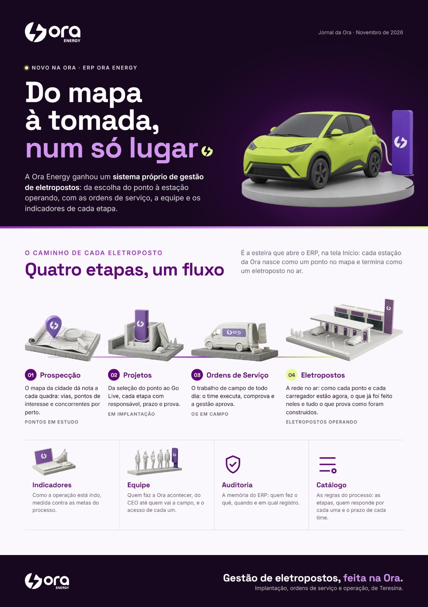
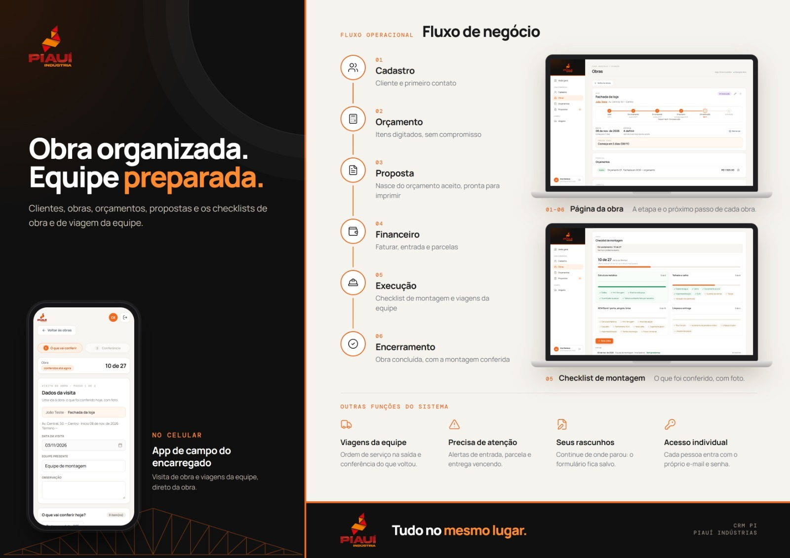

Software e automação sob medida para empresas que querem parar de perder tempo e dinheiro com processos manuais.

A ELOS escuta como a sua operação funciona, entende onde ela trava e constrói a solução que encaixa. Você não compra um sistema pronto e se adapta a ele.

## O que fazemos

- **Software sob medida.** Sistemas e aplicativos construídos para o processo da sua empresa.
- **Automação de processos.** Menos planilha, menos retrabalho, sistemas que passam a conversar entre si.
- **Consultoria e ensino.** Capacitação da equipe que vai operar a solução.

## Como trabalhamos

1. **Escuta.** Entendemos como a operação funciona hoje, com quem vive o processo.
2. **Diagnóstico.** Mostramos onde o processo trava e o que vale resolver primeiro.
3. **Construção.** Desenvolvemos a solução sob medida.
4. **Acompanhamento.** Seguimos ao lado da equipe depois da entrega.

O diagnóstico inicial é gratuito e sem compromisso.

## Trabalhos entregues

<table>
<tr>
<td width="50%"> <b>Ora Energy.</b> Aplicativo do motorista.</td>
<td width="50%"> <b>Ora Energy.</b> ERP da rede de eletropostos.</td>
</tr>
<tr>
<td> <b>Piauí Indústria.</b> CRM com aplicativo de campo.</td>
<td> <b>Grupo Ora.</b> Ora Compras, compras corporativas.</td>
</tr>
</table>

## Nossos repositórios

| Repositório | Descrição |
| --- | --- |
| [`elos`](https://github.com/elos-dev-hub/elos) | Landing page da ELOS: Next.js, TypeScript e Tailwind. |

## Valores

Inovação, adaptação, empatia e personalização.

## Fale com a gente

Agende um diagnóstico pelo WhatsApp. Respondemos no mesmo dia útil.
